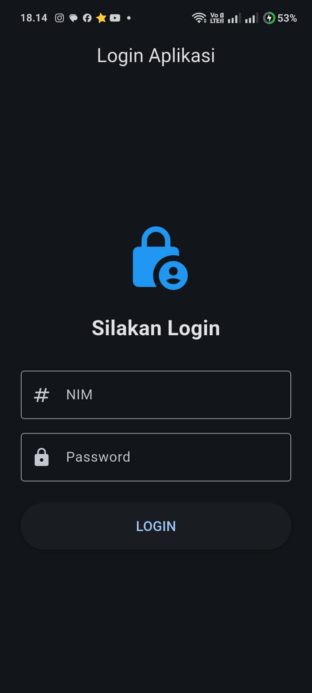
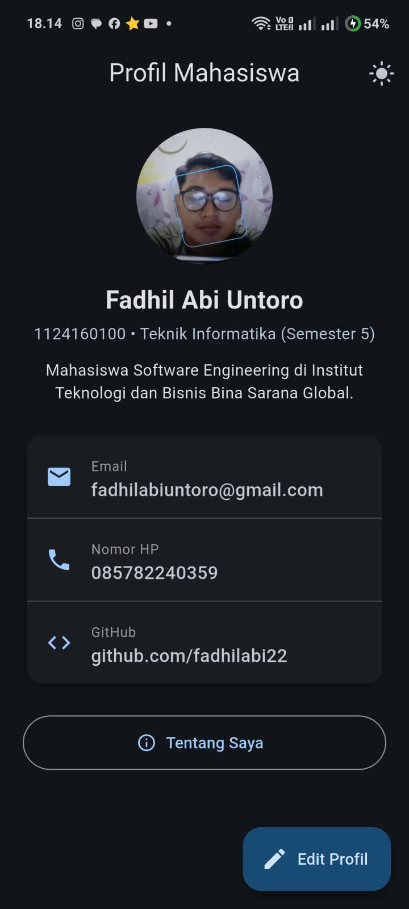
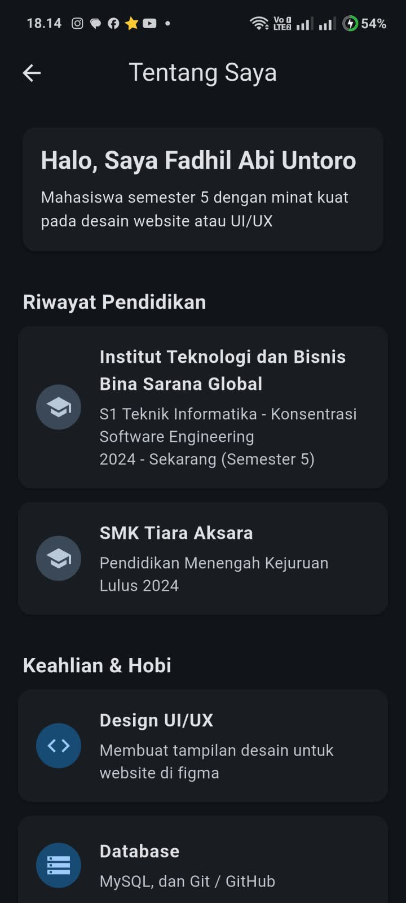
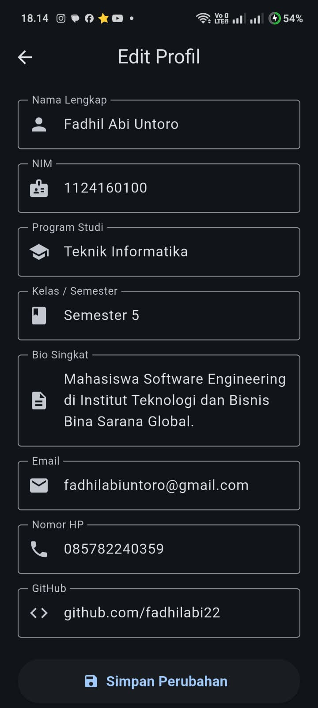

# UTS Pemrograman Mobile Lanjutan - Aplikasi Profil Mahasiswa

## Identitas Mahasiswa
* **Nama:** Fadhil Abi Untoro
* **NIM:** 1124160100
* **Program Studi:** Teknik Informatika (Konsentrasi Software Engineering)
* **Institusi:** Institut Teknologi dan Bisnis Bina Sarana Global
## Link Youtube
* Link:

## Screenshot Aplikasi

| Halaman Login | Halaman Profil | Halaman Tentang Saya | Halaman Edit Profil |
| :---: | :---: | :---: | :---: |
|  |  |  |  |
## Daftar Fitur
* **Login (`LoginPage`):** Validasi input email dan password sebelum masuk ke halaman utama menggunakan `Navigator.pushReplacement`.
* **Profil Mahasiswa (`ProfilePage`):** Menampilkan foto dari aset lokal (`assets/images/profile.jpeg`) dengan `CircleAvatar`, biodata lengkap, kartu kontak menggunakan *reusable widget* `InfoTile`, serta pengubah tema **Light / Dark Mode**.
* **Edit Profil (`EditProfilePage`):** Formulir pembaruan data menggunakan `TextEditingController` dan validasi `GlobalKey<FormState>`, lalu mengirimkan data terbaru kembali ke halaman profil via `Navigator.pop`.
* **Tentang Saya (`AboutPage`):** Menampilkan riwayat pendidikan, keahlian teknis, dan hobi menggunakan `ListView`.
## Cara Menjalankan Aplikasi
1. Clone repository ini ke komputer lokal: git clone [https://github.com/fadhilabi22/UTS-PML-1124160100.git](https://github.com/fadhilabi22/UTS-PML-1124160100.git)
2. Masuk ke direktori proyek : cd UTS-PML-1124160100/soal2-profil-app
3. Unduh seluruh paket dependensi: flutter pub get
4. Jalankan aplikasi pada emulator: flutter run